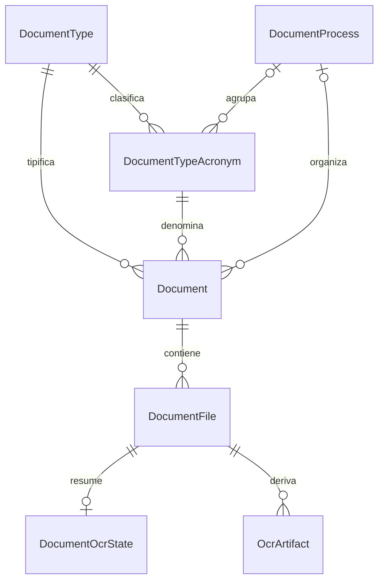

# Modelo de datos heredado

## Alcance

La primera API pública consulta el esquema PostgreSQL `normatividad` de la base `proyectos`.
No crea migraciones ni modifica el esquema. Las tablas fueron verificadas mediante
`information_schema` el 2026-10-30.

## Diccionario

| Modelo | Tabla | Identidad | Uso en esta etapa |
| --- | --- | --- | --- |
| `DocumentType` | `regulations_tipos` | `id` | Catálogo público filtrado por `tip_show_portal` |
| `DocumentTypeAcronym` | `regulations_tipos_siglas` | `id` | Siglas visibles y filtros directos |
| `DocumentProcess` | `regulation_processes` | `id` | Procesos activos independientes |
| `Document` | `regulations` | `id` | Metadatos publicados con `reg_status = 1` |
| `DocumentFile` | `regulation_files` | `id` | Archivo exacto perteneciente a un documento |
| `DocumentOcrState` | `regulation_file_ocrs` | `id` | Estado y cantidad de páginas |
| `OcrArtifact` | `regulation_file_ocr_artifacts` | `id` | Disponibilidad de artefactos activos |

## Diagrama



## Relaciones interpretadas

```text
DocumentType 1 ── * DocumentTypeAcronym
DocumentProcess 1 ── * DocumentTypeAcronym   (opcional)
DocumentType 1 ── * Document
DocumentTypeAcronym 1 ── * Document
DocumentProcess 1 ── * Document              (opcional)
Document 1 ── * DocumentFile
DocumentFile 1 ── 0..1 DocumentOcrState
DocumentFile 1 ── * OcrArtifact
```

PostgreSQL no declara claves foráneas para estas relaciones. Eloquent las interpreta por las
columnas existentes, pero el código debe tolerar padres ausentes.

## Decisiones de modelado

### Tipo y proceso independientes

`regulations_tipos_processes` existe, pero no contiene filas y no representa una regla vigente.
No se mapea ni se consulta. Si se necesita restringir tipos y procesos, se hará un rediseño.

### Identidad del archivo

El ID de `regulation_files` es la identidad canónica. La combinación
`file_idregulation + file_tomo + file_nro_tipo` no es única: se observaron 4,243 grupos
duplicados con 4,703 filas adicionales. Las rutas nuevas no usan esa combinación como clave.

### Artefactos OCR

Solo `regulation_file_ocr_artifacts.status = active` puede declarar una representación OCR
disponible. Además, el original y el archivo derivado deben existir físicamente.

Los 20 estados heredados con PDF y los 19 con texto que carecen de artefacto moderno pertenecen
a archivos ya ausentes de `regulation_files`. Por ello no se implementa fallback heredado.

### Integridad tolerada

En la inspección inicial se observaron:

- un archivo sin documento padre;
- 24 estados OCR sin archivo padre;
- nueve documentos publicados sin archivos;
- cero artefactos activos duplicados por archivo y tipo.

Los listados parten siempre del padre publicado y las relaciones exactas se verifican antes de
responder. Estos hallazgos no autorizan una limpieza de datos.

## Autoridad y escritura

- Esta API es de solo lectura en su primera etapa.
- El integrador OCR es el único escritor de artefactos.
- Los NFS permanecen montados en solo lectura.
- La conexión de producción pública deberá usar un rol PostgreSQL de lectura; la credencial local
  de desarrollo todavía posee permisos más amplios.

## Evidencia ejecutable

- Modelos: `backend/app/Modules/*/Models`.
- Consultas: `backend/app/Modules/*/Queries`.
- Pruebas aisladas: `backend/tests/Feature/PublicNormatividadApiTest.php`.
